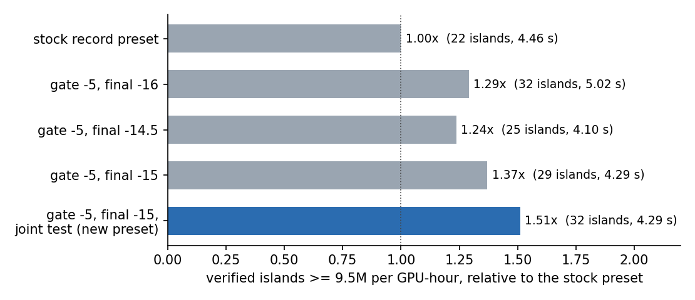
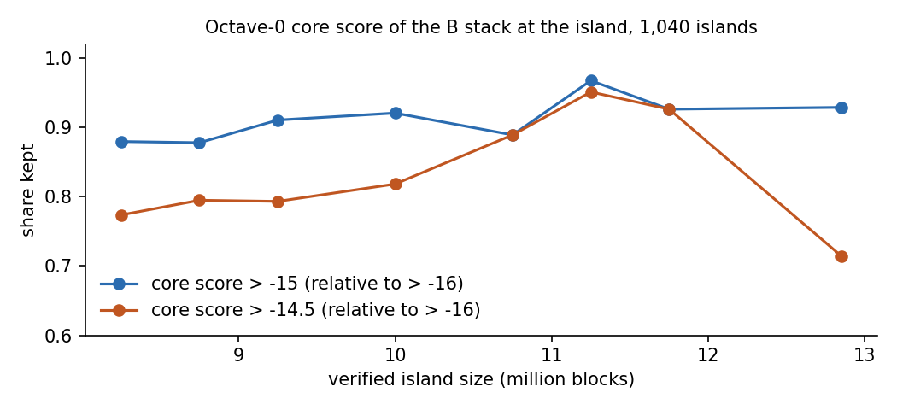

# Record tuning: what makes a mushroom island large, and a faster record build

This note covers the second round of work on the record preset (`make PRESET=record`, small biomes, bounded).
It explains what makes a mushroom island large and what limits its size, how that was turned into
size-dependent thresholds, and what was changed and measured. Measurements are from one RTX 4080 Super
(September 2026). `docs/search-economics.md` covers the first round.

## Summary

| | |
|---|---|
| Record-size islands per GPU-hour | About 1.5× the previous record preset. Verified islands of 9.5M and more on identical seeds: 32 against 22, at 1.04× the speed. |
| Time to an island above 12,618,448 | About 22 days of one RTX 4080 Super, against about 34 before; 68% range 10–46 days. About $120 on-demand, against about $180. |
| Main recall loss found | gradvecs_1's pre-gate looks at one layer of lattice nodes and drops about 40% of large islands. |
| Bug fixed | filter_2_01b wrote its outputs into its own input buffer. Candidates could be lost, which became frequent once kernels share the GPU. |
| Still the largest costs | Seed hashing (half the time, at its instruction floor) and the phase gate, which keeps about 54% of large islands and is size-neutral. |

## 1. Where the time goes

Record preset, bounded, 2.75 × 10¹¹ seeds (256 batches), 61.7 G seeds/s:

| Stage | Share | Per surviving seed |
|---|---|---|
| filter_seeds (hashing and phase gate) | 51% | (8.3 ps per seed) |
| filter_gradvecs_1 | 25% | 13.3 ns |
| filter_2_01a | 16% | 8.4 ns |
| init_seeds | 3% | 1.5 ns |
| everything after | 5% | |

- **Hashing** costs about 90 ALU-pipe instructions a seed, and the kernel is bound by that pipe. Six of them were the
  xoroshiro guard against an all-zero state. Skipping it (`TUNE_RAW_FORK`, probability 2⁻¹²⁸) makes the kernel 7%
  faster. Moving shifts and rotations to the FMA pipe as `IMAD.WIDE` made it slower, because `IMAD.WIDE` costs two
  issue slots.
- **gradvecs_1** is bound by shared-memory loads. Every column reads the convolution table at a different lag,
  so the loads collide on banks.
- **filter_2_01a** is bound by its sampling arithmetic, not by fetching the noise structs, which is 14% of it.

## 2. What makes a mushroom island large

Measured on 1,040 verified islands:

- 735 of 8–10.5M, found in runs without the gradvecs_1 gate on the same seed range as below.
- 271 from the leaderboard spreadsheet (bounded and unbounded, up to 13.66M).
- 24 others of 11M and more.

The tools are in `tools/analysis/`.

**Depth is saturated, size comes from spread.**
- The island interior averages C = −1.27 at every size from 8M to 12.6M: −0.95 from octave 0 (both stacks),
  −0.21 from octave 1, −0.09 from octave 2.
- The phase gate already puts both stacks' octave-0 y-offsets near the middle of a lattice layer. That makes each
  node with a favourable vertical gradient (bottom y = −1, top y = +1) a −0.5 plateau, so an island cannot get
  deeper.
- It can only spread. Big islands contain more favourable octave-0 nodes (3.1 in both stacks at 8M, 4.6 at 12M)
  and a larger joint octave-0 basin.

**How much each octave contributes.** Keeping an 11M island's octaves 0..L−1 and re-drawing the rest at random
gives, on average:

| Octaves kept | Mean area | Share of re-draws reaching 11M |
|---|---|---|
| 0 | 2.9M | 0.00 |
| 0–1 | 7.5M | 0.09 |
| 0–2 | 9.8M | 0.29 |
| 0–3 | 10.8M | 0.65 |
| 0–4 | 11.1M | 0.85 |

So a record island is an excellent octave-0/1 skeleton plus luck in octaves 2–4. Every island of 8M and more
already has a near-perfect 2×2 core of octave-0 nodes in both stacks, which is why the core alone does not predict
size.

**What limits the size.**
- The coast is not where the octave-0 basin ends: octave 0 is still −0.86 there, and only 4–5% of coast cells lie
  beyond the basin (above −0.6).
- From interior to coast C rises by 0.23, split 39% octave 0, 28% octave 2, 21% octave 1 and 15% octaves 3–8, the
  same at every size.
- An island ends where the deep part of the octave-0 basin runs out and octaves 1–2 can no longer make up the
  difference to −1.05.

**The phase y-offsets of octaves 3–5 look skewed in large islands (4–9σ). That is not physics.** Every octave's
y-offset is the same xoroshiro state XOR'd with a fixed salt, and the ++ scrambler is only additions, so the
offsets of different octaves are strongly correlated. Random seeds that pass the phase gate show the same skew.
This also explains the gate's pass rate of 1 in 3,285, where independent offsets would give 1 in 4,700.

## 3. Size-dependent thresholds

A threshold that keeps a larger share of big islands than of middling ones flattens the size tail.

- **Single-stack stages:** the phase gate, gradvecs_1's core score and filter_2_01a's area count are all flat
  between 8 and 10.5M.
- **Where the size dependence is:**
  1. In the strength of the octave-0 core beyond the 2×2 centre. Above about 10.5M the core score shifts up.
  2. Much more strongly, in the joint octave-0/1 skeleton of both stacks.

The core-score evidence uses the B stack, because the islands from my runs and the leaderboard islands passed the
same B-side filters.

Relative to a threshold of −16:

| Threshold | 8–10.5M | 11–12M | 12–13.7M |
|---|---|---|---|
| Core score > −15 | 0.89 | 0.93 | 0.92 |
| Core score > −14.5 | 0.79 | 0.92 | 0.69 |

For the joint octave-0/1 test (next section), on islands that have a lineage inside the border:

| Share kept | 8–10.5M | 10.5–13.7M | Ordinary gradvecs_2 outputs |
|---|---|---|---|
| Joint count ≥ 24 | 0.98 | 1.00 (48 islands) | 0.00055 |
| filter_2_01b (≥ 20) | 0.94 | 1.00 | 0.030 |

## 4. Changes

All of them are macros in `src/tune.h`; `PRESET=record` sets them, and a plain `make` is unchanged except for the
bug fix.

| Change | Setting | Effect |
|---|---|---|
| filter_2_01b writes to `buffer_1`, not its own input `buffer_2`; the cascade alternates from `buffer_2` | always | Removes a race that loses inputs and tests outputs twice |
| Skip xoroshiro's zero-state guard in the hashing | `TUNE_RAW_FORK 1` | Hashing −7%, same results |
| Hash batch i+1 on a low-priority stream while batch i runs the later kernels; cap gradvecs_1 and filter_2_01a at 2 and 3 blocks per SM so hashing blocks fit beside them | `TUNE_OVERLAP 1`, `TUNE_GV1_BPS 2`, `TUNE_A_BPS 3` | −7% time, same results |
| gradvecs_1 pre-gate −4 → −5 | `TUNE_GV1_Z0_GATE -5` | 1.45× islands of 9.5M and more per seed |
| gradvecs_1 final score −16 → −15 | `TUNE_GV1_FINAL -15` | 2.5× fewer filter_2_01a inputs; keeps 91% of 9.5M+ and about 93% of 11M+ islands |
| filter_2_01b (octaves 0B+1B < −0.55, ≥ 20 of 256) replaced by the joint test (0A+0B+1A+1B < −1.05, ≥ 24 of 256) | `TUNE_JOINT_B 24` | +10% islands, no cost; passes about 1/40 of what filter_2_01b did |

### Measurements

Island counts come from unbounded runs over the same 1.76 × 10¹³ seeds from `--start 555000000000000000`, with
candidate logging and relaxed late thresholds (MIN_2A..2D = 22, 100, 320, 1400). Candidates were clustered and every
island with a final count of 1,469 or more was verified with `tools/verify_largest.c`. Times are bounded,
2.75 × 10¹¹ seeds from `--start 777000000000000`.

| Build | Islands ≥ 9.0M | ≥ 9.5M | Bounded time |
|---|---|---|---|
| Previous record preset | 100 | 22 | 4.46 s |
| No gradvecs_1 pre-gate, final −16 (recall reference) | 150 | 36 | — |
| Pre-gate −5, final −16 | 134 | 32 | 5.02 s |
| Pre-gate −5, final −15 | 122 | 29 | 4.29 s |
| Pre-gate −5, final −14.5 | 115 | 25 | 4.08 s |
| **New preset** (−5, −15, joint test) | **129** | **32** | **4.29 s** |
| New preset with filter_2_01a ≥ 24 | 139 | 33 | 4.67 s |

- **Known islands:** started at each of 56 known bounded islands' seeds, the new preset finds 52 and the previous
  preset 49. The new preset recovers five that the previous one misses (leaderboard #3, #10, #18, #32, #34). It loses
  two: #6 (12.09M) and #36 (11.15M), whose octave-0A scores are −15.7 and −15.1. Both builds miss #8 (filter_2_01a
  count 24) and #21 (its bottom-layer pair fails even at −5).
- **Phase gate:** it stays best at 1.5; 1.75 is equal and 2.0 is worse.
- **Both layers:** gating both layers of lattice nodes (the pre-gate's missing half) recovers most of the other
  40% (97% of the no-gate candidates at −5) but doubles gradvecs_1's time. It is a net loss at present speeds.

## 5. Time to a record

The previous estimate is 1.8 × 10¹⁷ seeds of the previous preset per island above 12,618,448, give or take a
factor of 2. That is 34 days of one RTX 4080 Super at 61.7 G seeds/s. The README's "60 days of one RTX 4090" does
not follow from its own figures, which give about 22 days. With about 1.5× the islands per hour:

| | One RTX 4080 Super | One RTX 4090 | On-demand cost |
|---|---|---|---|
| Previous preset | 34 days | 22 days | ~$180 |
| New preset | ~22 days (10–46) | ~14 days | ~$120 |

## 6. Tried and dropped

| Idea | Result |
|---|---|
| Rotations and shifts on the FMA pipe (`IMAD.WIDE`), with multipliers hidden in constant memory so ptxas keeps them | Hashing 16–21% slower: `IMAD.WIDE` takes two issue slots |
| gradvecs_1 by pair join (good rows × good rows, per-lag lists) | Exact, 6–60% slower: irregular loads and divergence |
| gradvecs_1 by 256-bit row bitmaps | Exact, equal speed at best |
| Floor on the four central terms before scoring | ~2%; left out |
| 64-sample pre-test before filter_2_01a | Slower or equal: sparse samples lose the cell reuse |
| Linear window means or favourable-node counts as a filter_2_01a proxy | Too weak: keeping 99% of passes keeps 59–98% of inputs |
| Joint test with filter_2_01a relaxed to 24 | +3% islands for +9% time |
| gradvecs_1 score retrained for the tail: logistic model over 6 symmetric node classes, fitted on 128 islands of 10.5M and more against 1.1M ordinary windows | Held-out tail retention at equal output 0.906, the same as the present kernel's |
| filter_2_01a at a deeper level, at equal pass rate | Worse: −0.55 / 27 is optimal. −0.50 / 38 is equal; −0.60 / 20 keeps 87% of the tail against 99% |
| gradvecs_1 scan with the candidate row and value in one 64-bit broadcast and B in four bank-offset copies | No change (RTX 5090): the scan is not bound by bank conflicts |

## 7. Hardware

Blackwell (RTX 5090, 170 SMs) hashes at 0.85× the per-SM rate of Ada. Its integer units do not help this kernel,
which is still half the time. The phase gate's optimum does not move.

| | Previous preset | New preset | Seeds per dollar at $0.41/h, $0.22/h |
|---|---|---|---|
| RTX 5090, `sm_89` | 2.56 s (107 G seeds/s) | 2.54 s | 0.96 × 10¹⁵ |
| RTX 5090, `sm_120` | 2.51 s | 2.53 s | |
| RTX 4080 Super | 4.46 s | 4.29 s | 1.07 × 10¹⁵ |

Times are per 2.75 × 10¹¹ bounded seeds.

## 8. Where the remaining losses are

Of the large islands in the seeds the new preset scans, it finds roughly 35–40%.

| Stage | Share of large islands lost | Size-dependent? |
|---|---|---|
| Phase gate | ~46% | no |
| gradvecs_1 bottom-layer pre-gate | ~26% | no |
| gradvecs_1 final −15 | ~7% | slightly |
| filter_2_01a, joint test, cascade | ~1% each | |

The first two are size-neutral. Recovering them costs hashing and scanning time, which is spent before any
size-dependent information exists. A downstream tail filter cannot pay for loosening them.

- **Top-layer scan:** gating the top layer of lattice nodes as well recovers most of the second loss. It would pay
  once its scan costs under a fifth of what it does now (1.6 s per 2.75 × 10¹¹ seeds on an RTX 4080 Super).
- **What bounds the scan:** by elimination, instruction issue.

## 9. Tools

`tools/analysis/` contains:

- a CPU port of the whole GPU pipeline (`cpipe.hpp`), which reproduces the GPU's stage counts;
- the programs used above: anatomy, octave-level decomposition, coast attribution, basins, lattice features and the joint test.

`tools/analysis/README.md` lists them.
