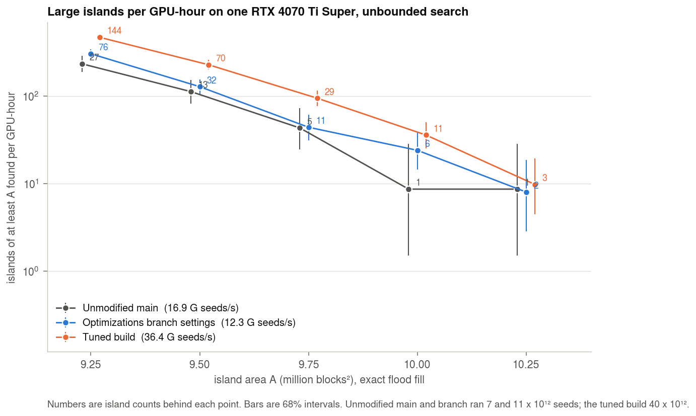
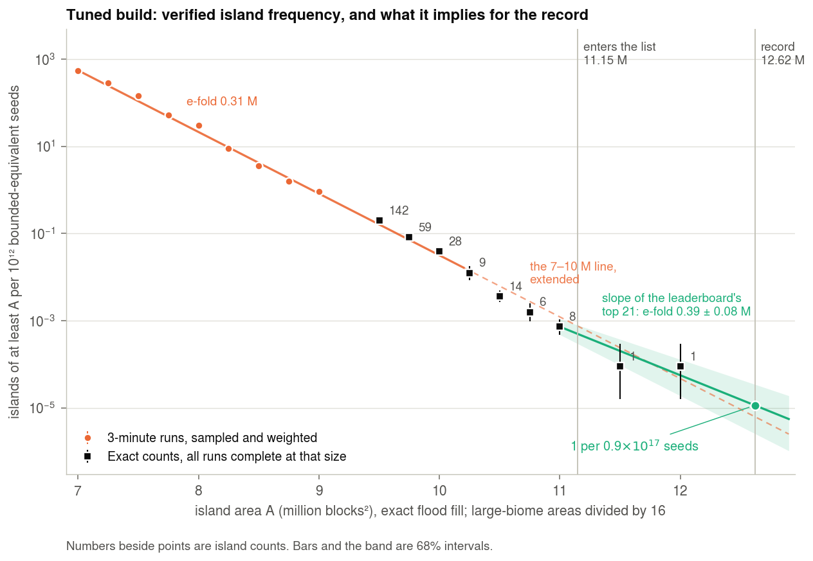

# Search economics

What an island of a given size costs to find, how that was measured, and what this branch changes.

Every yield below is a **verified** area: the flood fill the program's CPU stage uses, run to find the largest
connected island at each candidate (`tools/verify_largest.c`). Measurements were taken on rented GPUs on
28–30 September 2026. "Bounded-equivalent seeds" counts an unbounded seed as 8.28 bounded ones, because it
offers 8.28 times the positions. Large-biome areas are divided by 16.

## Summary

| Question | Answer |
|---|---|
| Is the tuned build better than the unmodified program? | Yes. On identical seeds it finds about 2× the islands of 9.25–10M per GPU-hour of unmodified `main`, and of the `optimizations` branch's settings. |
| How does frequency fall with size? | Exponentially, e-fold 0.31M from 7M to 10M and 0.30 ± 0.06M above 11M. Counts at 10.5–11M are about 0.6 of the 7–10M line extended. |
| Seeds per island above the bounded small-biomes record (12,618,448) | About 1.8 × 10¹⁷; 68% range 0.8–3.8 × 10¹⁷, 95% range 0.4–8 × 10¹⁷. It rests on 24 islands above 11M in 3.2 × 10¹⁶ seeds. |
| Cost of that | About $180 on-demand (68% range $80–380). About $60 on interruptible machines, when they run. |
| Largest island found during this work | 12,057,440, seed 800170121910237794, at (−13,597,226, −11,697,810). It would rank 6th on the bounded small-biomes list. |
| Softest leaderboard | Unbounded small biomes: a top-5 place costs about 3% of the bounded small-biomes record. The large-biomes lists are harder than their sizes suggest. |

The estimate of the record's cost moved several times during this work ($135, $46, $200–350, $120) before the
sample was large enough to hold it steady. Section 5 records why, and what the present figure rests on.

## 1. Overflow in the large-biomes pre-test

`cubiomes_test_monte_carlo` computed the coverage target as

```c
double fraction = (double)min_area / (r.sx * r.sz * r.scale * r.scale);
```

For large biomes the product is 12,800 × 12,800 × 4 × 4 = 2,621,440,000, which exceeds `INT_MAX`. The
target became negative and the pre-test accepted every position: 40 of 40 arbitrary positions, against 0 of 40
for small biomes. Nothing wrong was reported, because the flood fills that follow are correct, but every GPU
candidate paid for a flood fill. This branch computes the product in `double`; the same test then accepts 0 of 40.

## 2. The GPU's area is an estimate, and a loose one

The last GPU stage counts samples below −1.05 in a 10,240-block window. That is not connected area.

| Candidates | Verified area ÷ estimated area |
|---|---|
| All candidates estimated at 9.4M or more | median 0.50; 3% are above 0.9 |
| Islands that verify at 10.4M or more | 0.82–0.98 (estimate 2–22% high) |

Two consequences. Configurations must be compared on verified islands. And a cascade cut at an estimated X is
complete only for islands of about X ÷ 1.02 and more.

## 3. Comparison with the unmodified program

Four builds scanned the same 7.0 × 10¹² consecutive seeds, unbounded, on one RTX 4070 Ti Super. `main` was
changed only to log its candidates and to pass on candidates from an estimated 9.4M. The `optimizations` row is
this code with every tunable at that branch's value, its original image scan, and consecutive seeds.

| Build | G seeds/s | ≥ 9.25M | ≥ 9.5M | ≥ 9.75M | ≥ 10M | Islands ≥ 9.5M per GPU-hour |
|---|---|---|---|---|---|---|
| `main`, unmodified | 16.9 | 26 | 12 | 4 | 1 | 104 |
| `optimizations` settings | 12.4 | 45 | 18 | 5 | 2 | 114 |
| Tuned (`PRESET=record`) | 36.2 | 29 | 13 | 4 | 1 | 242 |
| Tuned, gate −5 | 26.8 | 35 | 17 | 5 | 1 | 234 |



The tuned build finds as many large islands per seed as `main` and scans 2.1 times as many seeds per second.
The branch's defaults find more per seed and scan a third as many.

On 38 known islands of 10.9M and more, each run from its own seed, the tuned build finds 30 and the same build
with gate −5 finds 37.

## 4. The size law



Tuned build, per 10¹² bounded-equivalent seeds:

| Size | Islands of at least that size | Source |
|---|---|---|
| 7.0M | 551 | 3-minute runs, stratified sample |
| 8.0M | 30 | same |
| 9.0M | 0.92 | same |
| 9.5M | 0.20 | six 7-minute runs on fresh seeds, 142 islands |
| 10.0M | 0.039 | same, 28 islands |
| 10.25M | 0.013 | same, 9 islands |
| 10.5M | 0.0036 | runs cut at 10.4M or lower, 85 islands in 2.4 × 10¹⁶ seeds |
| 10.75M | 0.0016 | same, 37 islands |
| 11.0M | 0.00076 | all runs, 24 islands in 3.2 × 10¹⁶ seeds |
| 11.5M | 0.00016 | same, 5 islands |
| 12.0M | 0.00003 | same, 1 island |

From 7M to 10M the points follow exp(−A / 0.31M). A power law fits 7–10M equally well and is ruled out above
it. From 10.5M to 11M the counts are about 0.6 of that line extended. Above 11M the 24 islands found have a
mean excess of 0.30 ± 0.06M, and the leaderboard's 21 entries above 11.5M have 0.39 ± 0.08M. Within these
errors one exponential describes 7M to 12M to a factor of about 1.5.

## 5. What a record costs, and how the estimate moved

The estimate is fixed as: the rate at 11.0M from every run that is complete there, times exp(−1.618M / b),
where b combines the mean excess of the islands above 11M with the leaderboard's slope, weighted by inverse
variance. Runs that repeated another run's seeds are counted once.

Rate at 11.0M: 24 islands in 3.2 × 10¹⁶ seeds, 7.6 × 10⁻¹⁶ per seed. Slope: 0.30 ± 0.06M from these islands,
0.39 ± 0.08M from the leaderboard, 0.33 ± 0.05M combined.

| | Seeds per island ≥ 12.618M | On-demand, 1.0 × 10¹⁵ seeds per $ | Interruptible, 2.8 × 10¹⁵ seeds per $ |
|---|---|---|---|
| Central | 1.8 × 10¹⁷ | $180 | $63 |
| 68% range | 0.8 – 3.8 × 10¹⁷ | $80–380 | $29–136 |
| 95% range | 0.4 – 8 × 10¹⁷ | $38–820 | $14–290 |

The slope contributes a factor 2.1 of the uncertainty, the count a factor 1.25. Without the largest island the
figure is 2.8 × 10¹⁷.

| Earlier figure | What it rested on | What was wrong |
|---|---|---|
| $135 on-demand | The 7–10M line extended to 12.6M: 1.3 × 10¹⁷ seeds | Close to the present figure, but unchecked above 10M when given |
| $46 on a cheap machine | The same seeds at an interruptible machine's price | That machine was paused by its host most of the time |
| $200–350 | 3 islands above 10.9M and a slope of 0.28M | Too few islands; with 10, the rate was 1.4 times higher and the slope 0.34M |
| $120 | 8 islands above 11M, slope 0.34–0.39M | Too few islands; each new island moved the slope. With 24 the slope is 0.30M and the figure $180 |

A "bend at 9.5M" was also reported and withdrawn. Nine configurations had been run over one stretch of seeds
that happened to hold few large islands; they were one sample, not nine. Fresh seeds put the tuned build on its
line to 10M. Seed order was tested directly and does not matter:

| Seed order | Seeds | ≥ 9.25M | ≥ 9.5M | ≥ 9.75M | ≥ 10M |
|---|---|---|---|---|---|
| Chain | 4.65 × 10¹³ | 162 | 78 | 25 | 14 |
| Consecutive | 4.00 × 10¹³ | 140 | 64 | 34 | 14 |

## 6. The other categories

Islands per 10¹² seeds, tuned build, equivalent sizes:

| Size | Unbounded small | Unbounded large | Bounded large | Bounded small |
|---|---|---|---|---|
| ≥ 7.0M | 5,180 ± 780 | 3,870 ± 620 | 25.9 ± 3.6 | 692 ± 137 |
| ≥ 7.5M | 1,210 ± 240 | 1,170 ± 210 | 7.0 ± 1.2 | 152 ± 38 |
| ≥ 8.0M | 226 ± 50 | 269 ± 78 | 1.7 ± 0.5 | 27.5 ± 6.4 |

| Category | Positions per seed | G seeds/s, RTX 4080 Super | Islands per GPU-hour against bounded small |
|---|---|---|---|
| Bounded small | 115 × 115 | 59.8 | 1 |
| Unbounded small | 331 × 331 | 49.5 | 6.9 |
| Unbounded large | 331 × 331 | 58.9 | 8.2 |
| Bounded large | 29 × 29 | 71 | 0.06 |

Large-biome islands are rarer at the top than small-biome islands of the same equivalent size. A 97-minute
unbounded large-biomes run, 5.6 × 10¹⁴ seeds, found:

| Size | Equivalent | Found | Small-biomes rate predicts |
|---|---|---|---|
| ≥ 168M | 10.5M | 7 | 17 |
| ≥ 172M | 10.75M | 1 | 7.4 |
| ≥ 176M | 11.0M | 0 | 3.4 |

So the large-biomes records cannot be priced from the small-biomes curve, and are not cheaper than it suggests.
For unbounded small biomes the curve is the same as bounded (section 5 pools both):

| Target, unbounded small biomes | Size | Cost against the bounded small-biomes record |
|---|---|---|
| Lowest entry | 11.52M | 0.009 |
| 5th | 12.01M | 0.03 |
| 2nd | 12.47M | 0.1 |
| Record | 13.66M | 2 |

## 7. What the known record islands look like

Gradients around 230 known islands of 10M-equivalent and more:

| Octave | Lattice points inside the island with favourable vertical gradients in both layers | Chance |
|---|---|---|
| First | 95% | 14% |
| Second | 35% | 14% |
| Third | 18% | 14% |

The first octave must be essentially perfect in both stacks, which the gradient filters already test. Twenty
lattice-alignment quantities, between octaves and between the two stacks, are uniform among these islands: there
is no further seed-level variable to filter on.

Offset density of 40 islands of 9.25M and more, found with wide filters: exp(−379 d₀² − 106 d₁² − 5.3 d₂²),
with errors of 99, 21 and 1.9. The preset's weights are 350, 55 and 4.

## 8. Seed filter and thresholds

Variants on identical seeds (2.6 × 10¹³, unbounded), islands per GPU-hour against the preset:

| Seed filter | G seeds/s | Passes 1 in | ≥ 9.25M | ≥ 9.5M | ≥ 9.75M |
|---|---|---|---|---|---|
| 350 d₀² + 55 d₁² + 4 d₂² < 1.5 (preset) | 36.7 | 3,285 | 1.00 | 1.00 | 1.00 |
| Same, < 1.25 | 44.1 | 4,995 | 0.96 | 0.96 | 0.83 |
| Same, < 2.0 | 24.7 | 1,771 | 0.86 | 0.83 | 0.88 |
| 350 d₀² + 100 d₁² + 5 d₂² < 1.5 | 46.9 | 5,544 | 0.89 | 0.93 | 0.79 |
| Same, < 2.0 | 32.4 | 2,824 | 0.91 | 0.92 | 1.02 |
| 250 d₀² + 80 d₁² + 8 d₂² < 1.0 | 64.1 | 15,931 | 0.57 | 0.60 | 0.54 |

The preset found 98, 44 and 13 islands at the three sizes; errors on the ratios are about 0.1, 0.15 and 0.25.
No variant beats it.

Earlier measurements at 7.5–8.5M, which turned out not to predict large islands reliably, are left out. Gate
−4 and gate −5 give the same yield per hour; −5 finds a quarter more islands per seed at three quarters of the
speed.

## 9. What this branch changes

| Change | Measured effect |
|---|---|
| Stack-B image scan walks lattice columns and scores each cell once | Unbounded small +12%, unbounded large +9%, bounded +3%. Stage counts identical, table by table. |
| Quadratic seed filter, 2³⁰ seeds per iteration (`PRESET=record`) | With chain hashing, 2.1× the seeds per second of `main` at equal large-island yield per seed |
| Chain hashing: seeds visited as t₀ + k·GOLDEN, one `mix64` per seed | Hashing 10.8 → 10.1 ps per seed. Yield per seed unchanged (section 5). |
| Every threshold is a macro in `src/tune.h` | None by default |
| Candidate log (`TUNE_LOG_CANDIDATES`) | Needed by the measurements |
| Overflow fix | Section 1 |
| Binary names `main-sb`, `main-sbu`, `main-lb`, `main-lbu` (`-record` appended for the preset) | Section 12 |
| `tools/verify_largest.c`, `tools/cluster_candidates.py`, `tools/size_fit.py` | Measurement tools |

The maintainers' notes in `gpu.cu` record that hashing and the stack-A lattice scan are at their floor, and
that a sparse join for the lattice scan gained nothing. Nothing found here contradicts that.

Tried and dropped: testing a quarter of the 256 area samples first, and skipping the rest when none is below
the threshold. It made the bounded search slower, 49.8 → 44.8 G seeds/s. Almost every candidate that reaches
the area test has some samples below the threshold, so it paid for both tests.

## 10. Hardware

Tuned build. Bounded speeds for the RTX 5090, 4080 Super and 4070 Ti Super were measured with the column scan;
the others before it, with 3% added. Unbounded speeds are before it; add 12%.

| Card | Bounded, G seeds/s | Unbounded | $/h on-demand | 10¹⁵ bounded seeds per $ |
|---|---|---|---|---|
| RTX 4070 Ti Super | 49 | 36.5 | 0.175 | 1.01 |
| RTX 5090 | 120 | 87.7 | 0.446 | 0.97 |
| RTX 4090 | 95 | 69.7 | 0.353 | 0.97 |
| RTX 4080 Super | 56 | 42.0 | 0.216 | 0.93 |
| RTX 5080 | 66 | 46.0 | 0.279 | 0.85 |
| RTX 5070 | 39 | 29.7 | 0.198 | 0.71 |
| RTX 4060 Ti | 25.4 | | 0.092 | 1.00 |
| RTX 3080 | 25.3 | | | |
| RTX 3060 Ti | 19.1 | | 0.056 | 1.24 |

- Two cards in one machine give exactly twice one card (`--device 0,1`): 122.6 and 244.2 G seeds/s on two RTX 5090.
- Multi-GPU machines cost the same per card as single ones on-demand. Machines with four or eight cards never
  started for this account.
- The on-demand market prices cards close to their speed at this work: the best offers of every model give
  1.0–1.25 × 10¹⁵ seeds per dollar, and a fleet of the cheapest per seed ran at 1.0–1.1 × 10¹⁵ overall.
- Interruptible machines cost a third to two thirds as much. A two-card RTX 5090 at $0.30/h gave
  2.8 × 10¹⁵ seeds per dollar, but ran 1–7% of the time. A paused instance stays stopped until it is asked to
  start again (`vastai start instance`); asked, it came back at once at the same bid, for 12 minutes. Raising
  the bid did nothing. The listed minimum bid is not a price at which a machine is available: bids placed 12%
  above it mostly did not start.
- Check the GPU is idle before starting (`nvidia-smi --query-gpu=memory.used,utilization.gpu`): two hosts
  had another job on the card. One host lost its GPU five minutes into the run and kept billing; watch the
  seeds delivered per wall-clock hour, not only the program's own speed figure.

## 11. How to measure a change

Count islands of 9.5M and more. Yields at 7–8M did not predict them.

```sh
# unbounded, candidates from an estimated 9.4M, candidate log on
make PRESET=record UNBOUND=1 TUNE="-DTUNE_LOG_CANDIDATES=1 -DTUNE_MIN_2A=22 -DTUNE_MIN_2B=100 -DTUNE_MIN_2C=320 -DTUNE_MIN_2D=1469 -DTUNE_CHAIN_HASH=0"
timeout -s INT -k 5 420 ./main-sb --device 0 --threads 1 --size 30000000 --start 60000000000000000
tools/cluster_candidates.py candidates-dev0.txt > islands.txt
./verify_largest 0 1000000 < islands.txt > verified.txt
```

- Seven minutes on one RTX 4070 Ti Super gives about 25 islands of 9.5M and more.
- To compare two builds, give both the same `--start` and `-DTUNE_CHAIN_HASH=0`, and compare over the seeds both covered.
- To estimate a rate, use seeds no other run in the estimate has used.
- Always include the unmodified program.

## 12. Notes

- Leaderboard entry 3 of the bounded small-biomes list (seed −7182859830324569414) has the wrong sign on Z.
  The island is at X −21,178,622, Z −15,547,496.
- Before this branch the binary was always named `main-sb`, because the makefile compared the literal names
  `UNBOUND` and `LARGE_BIOMES`. The build options themselves were applied correctly. The names are now
  `main-sb`, `main-sbu`, `main-lb`, `main-lbu`, with `-record` appended for `PRESET=record`.
- Two runs given the same `--start` scan the same seeds in the same order. Give every run its own start, and
  keep a list.
- Small-biomes islands of 11M and more found during this work, all verified (3.2 × 10¹⁶ bounded-equivalent
  seeds, 28–30 September 2026):

| Area | Seed | X | Z | Inside the border |
|---|---|---|---|---|
| 12,057,440 | 800170121910237794 | −13,597,226 | −11,697,810 | yes |
| 11,888,736 | −3025531115150437153 | −13,580,933 | −5,406,252 | yes |
| 11,797,072 | −2052608274927130910 | −17,457,048 | 17,668,663 | yes |
| 11,534,784 | 7731762201905736669 | −28,121,486 | 20,046,397 | yes |
| 11,472,448 | 5009903866501282277 | −19,192,792 | −30,108,592 | no |
| 11,456,528 | 2867790290326774825 | −45,845,553 | −83,237,840 | no |
| 11,408,320 | −3627150617005451538 | 52,262,557 | −18,027,173 | no |
| 11,397,216 | 5327440867002669947 | −18,008,390 | 3,549,173 | yes |
| 11,348,816 | −176624150459012664 | 16,779,993 | 25,288,656 | yes |
| 11,239,104 | 5100723390677480553 | −8,143,278 | −25,280,200 | yes |
| 11,228,912 | 7301541851289047939 | 6,338,932 | 24,925,276 | yes |
| 11,209,008 | 6824100281803813586 | 24,313,177 | 24,350,328 | yes |
| 11,182,288 | −6624415972347141121 | 45,603,808 | 32,898,005 | no |
| 11,157,344 | 8937455382381243801 | −13,099,670 | 14,480,652 | yes |
| 11,156,784 | −4283052858621480260 | −2,072,665 | 16,173,709 | yes |
| 11,146,624 | 8009243044973297155 | −17,429,130 | −1,947,568 | yes |
| 11,142,640 | 929408023794931829 | −17,874,950 | 4,592,923 | yes |
| 11,112,656 | 1249275856368963826 | 18,332,916 | 7,358,504 | yes |
| 11,110,128 | −1099353680545824005 | −11,528,580 | 9,592,979 | yes |
| 11,050,880 | −4083470699792885698 | 448,300 | −7,767,619 | yes |
| 11,038,016 | 6789772653027294032 | −4,756,257 | −27,126,216 | yes |
| 11,030,592 | −1503500982490932076 | −4,032,255 | −23,038,304 | yes |
| 11,029,072 | 5041579890390030755 | −78,403,929 | 20,667,490 | no |
| 11,014,352 | 1424400111561129708 | 1,185,046 | 15,865,665 | yes |
